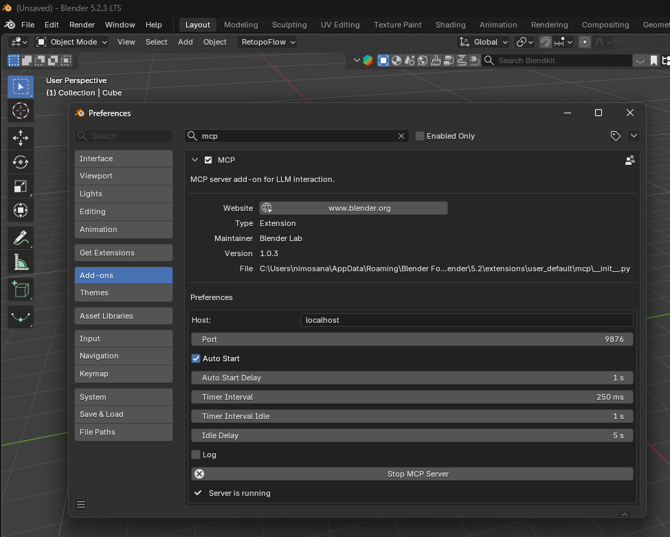
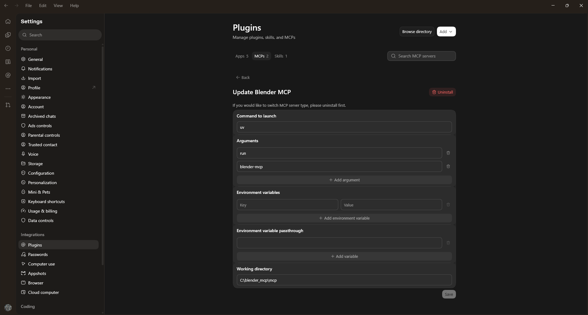

# Blender MCP Set-up guide

## Requirements
- A computer capable of running the apps you want to use through MCP
- Internet connection
- Access to an online AI model (Ex. ChatGPT, Claude) OR a local AI model

## Setup

### 1. Download & Extract Blender MCP
Download/extract the Blender MCP project to your computer: https://projects.blender.org/lab/blender_mcp/ 
- (Windows ex: download/extract to `C:\blender_mcp`)
- (MacOs ex: download/extract to `~/blender_mcp`)



### 2. Install UV
Install UV: https://docs.astral.sh/uv/getting-started/installation/ 

**Windows — PowerShell:**
```powershell
powershell -ExecutionPolicy ByPass -c "irm https://astral.sh/uv/install.ps1 | iex"
```

**MacOS — Terminal:**
```bash
curl -LsSf https://astral.sh/uv/install.sh | sh
```

### 3. Install Blender Lab MCP Add-on
Install the Blender Lab MCP add-on using the official instructions: https://www.blender.org/lab/mcp-server/
- **3.1** Enable it in Blender.
- **3.2** Restart Blender and keep it running when testing the connection.

### Option A
Use a desktop AI client, such as ChatGPT or Claude Code, and configure the MCP server in the application's settings. 



### Option B
Configure another local AI client or a different MCP-compatible application. (out of scope for this presentation)

## Demo
[](https://youtu.be/eG38Qbcc9TI)

[Blender MCP bike demo](https://youtu.be/eG38Qbcc9TI)

## Final Result:
[](https://youtu.be/nAdAzdxA4yI)

[Bike demo result](https://youtu.be/nAdAzdxA4yI)

